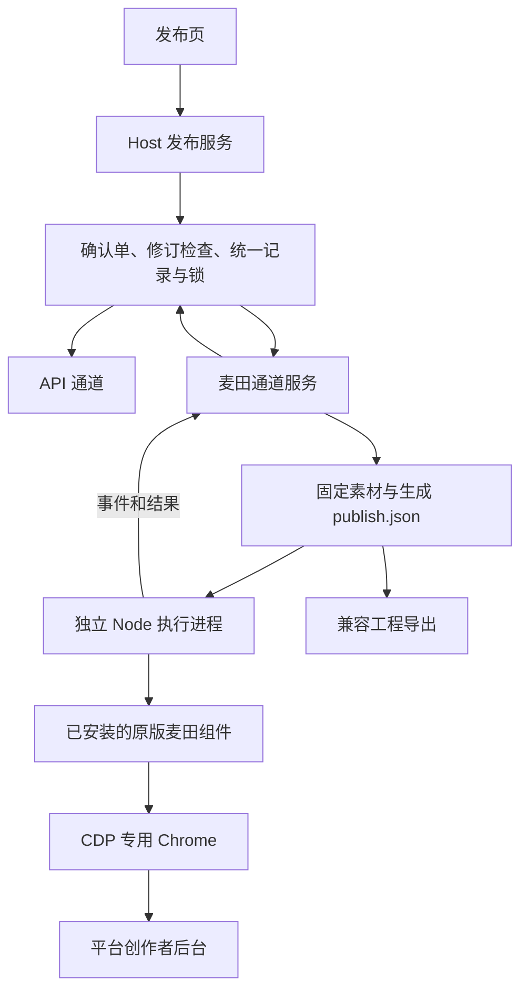

# 麦田发布组件兼容方案

日期：2026-11-22
适用项目：PromptHub MediaDesk（`prompthub-media-desk`，当前版本 2.6.2）
状态（2026-11-23）：部分实现；工程导出、组件探测、浏览器配置/登录预检、记录 v2 迁移、服务端确认单与原版填写执行链路已开发；结果查询、人工核对及历史操作已接入；正式准备与填写确认 UI 已接入，真实填写开关未开放；已接入自有快照自动清理、七天终态保留及容量检查；已补齐旧 API 中断核对与升级指引，以及正式目录迁移后的副本归属管理；真实平台验收仍待完成。
审查状态：已完成阅读基线静态审查、连接层自动化测试、专用 Chrome 传输验证及官方商店 CRX 分发包的只读模块/工程核验；专用 Chrome 实装、真实升级与平台联调仍待验证。
当前交付目标（按用户本轮澄清）：本项目生成兼容的 `publish.json`、成片和封面工程，用户在原版麦田发布助手中导入并执行；不修改助手代码，平台适配与助手更新由上游维护。Node 直接加载助手模块的执行路线暂缓，不作为当前使用的前置条件。

开发记录与后续任务：[麦田集成开发进度](maitian-development-progress.md)。本文的未勾选验收项仍为交付条件，不因局部代码或模拟测试通过而自动完成。

## 1. 设计结论

当前主流程固定为：**本项目整理稿件与媒体 → 校验并导出麦田工程 → 原版发布助手选择工程父目录并填写本机路径 → 在助手中选择平台并开始填写 → 用户在平台完成最终发布。** 不要求下载、启动麦田监控中控，不要求用户先跑本项目的 Node 直驱执行器。

现有「校验并导出麦田工程」入口继续使用。工程导出现在通过独立 `exportComponentDir` 加载原版校验器，与专用 Chrome 的浏览器设置分离；路径由用户本机配置，不写死开发机目录。服务端直驱入口默认关闭。用户已确认本地原版插件可用；历史 `Not allowed` 源码诊断保留供特定安装形态排查，不再标记为当前流程阻塞。真实平台发布仍需单独回归。

后文关于独立 runner、CDP 连接层、直接开始填写、任务确认单和运行时更新的设计，作为已开发的实验路线保留，暂缓交付。已有未提交代码不因本次收敛而删除。当前验收优先检查工程协议、媒体文件、助手实际导入及助手原生执行结果。现有 API 投稿通道继续沿用原有逻辑。

### 1.1 已开发直驱实验路线的约束（暂缓交付）

1. **组件外置**：默认读取专用 Chrome 中从应用商店安装的「麦田发布助手」，由 Chrome 按上游渠道更新。本项目不打包一份固定平台引擎作为默认运行依赖。
2. **上游文件只读**：不得修改扩展目录，不维护 fork，不复制其平台适配器到本项目后自行迭代，不对加载代码做字符串替换、补丁或 monkey patch。
3. **直接调用能力入口**：调用上游导出的填写、预检、查询和校验接口。DOM 选择器、话题选择、封面操作、上传等待、平台时间控件均归上游维护。
4. **我们维护连接层**：负责组件发现、数据转换、独立进程、Chrome API 兼容层、任务记录和 UI。允许调整自己的连接层来适应上游接口变化，不修改上游代码。
5. **兼容更新自动采用**：新任务重新发现已安装版本，探测契约后自动采用兼容更新，无需重新发布本项目或手工更新一份平台代码。
6. **有边界地处理破坏性更新**：上游没有对本项目承诺稳定 SDK。接口发生破坏性变化时，停止该操作并报告缺失能力；更新我们的连接层，或使用原版插件面板处理导出的工程。不能保证任意未来版本零适配。

此原则优先于本文其他实施细节。不得通过“为改善校验、身份读取或结果查询”引入第二套平台自动化实现。

此前规划的两步路线如下；当前仅推进第 1 步，不将第 2 步作为助手原生发布的必需步骤：

1. 导出麦田兼容工程，使用独立插件验证工程格式、文案、封面和真实页面。
2. 通过独立执行进程加载已安装的原版组件，调用其导出入口，在工作台展示登录情况、填写进度和发布结果。

第一轮闭环只支持小红书、视频号的单篇视频。支持立即发布页填写与平台预约填写；两种情况都由用户在平台点击最终发布。预约表示提前填写平台原生定时，不代表工作台会等到指定时间再启动上传。

复用范围为工程协议、原版填写引擎、预检、校验和链接查询。任务、确认单、文件快照、锁、状态和恢复由本项目管理。麦田的网页、SQLite、常驻调度、飞书通知、课程站、AI 文案接口不属于本次接入范围。

**麦田主程序不是当前工程导出与助手原生执行的前置依赖。** 2026-11-23 曾在本工作区下载、启动官方中控，进行外部 CDP 本地文件选择对照。这条对照路线偏离了用户当前要求，现已停止中控网页服务；下载源码与未提交实现保留，不作为产品依赖。该对照没有修复助手侧栏报错，详见[原版中控本地对照记录](maitian-upstream-local-check.md)。

本文中的新增字段、目录和接口是建议实施契约。实现时如需调整，应同步修改本文、迁移逻辑及验收用例。

## 2. 已核对的代码基线

| 项目 | 阅读基线 | 作用 |
| --- | --- | --- |
| 本项目 | `028d2af320d2ec5e9d955f0e3b18d43bc1498941` | 当前发布、素材、存储与界面实现 |
| 麦田中控 | `CzzzzzzJ/mdldm-maitian`，`d1eb1c83b26be6d6f72ebda84e5d9c60cd64a8b6` | 驱动加载和 Chrome 兼容层参考 |
| 麦田发布助手 | `CzzzzzzJ/mdldm-maitian-publisher`，`171a30a3b8db7e4539e74f108f3d789a46172dab`，manifest 0.5.1 | 公开的平台适配器与工程协议 |

可复查的上游基线入口（不是最新版承诺）：

- 中控加载与调用：[plugin.mjs](https://github.com/CzzzzzzJ/mdldm-maitian/blob/d1eb1c83b26be6d6f72ebda84e5d9c60cd64a8b6/src/plugin.mjs)、[driver.mjs](https://github.com/CzzzzzzJ/mdldm-maitian/blob/d1eb1c83b26be6d6f72ebda84e5d9c60cd64a8b6/src/driver.mjs)、[chrome-shim.mjs](https://github.com/CzzzzzzJ/mdldm-maitian/blob/d1eb1c83b26be6d6f72ebda84e5d9c60cd64a8b6/src/chrome-shim.mjs)。
- 原版入口与工程规则：[publish.js](https://github.com/CzzzzzzJ/mdldm-maitian-publisher/blob/171a30a3b8db7e4539e74f108f3d789a46172dab/lib/publish.js)、[bundle.js](https://github.com/CzzzzzzJ/mdldm-maitian-publisher/blob/171a30a3b8db7e4539e74f108f3d789a46172dab/lib/bundle.js)。

### 2.1 本项目可以复用的能力

| 文件 | 现状 | 接入时的用途 |
| --- | --- | --- |
| `src/publish/service.js` | prepare/start/review、确认单、修订检查 | 复用流程约束，增加通道分派 |
| `src/publish/records.js` | 发布记录、原子写入、活动任务判断 | 统一防重、状态和恢复 |
| `src/publish/snapshot.js` | 选材校验、摘要、私有副本 | 生成固定的工程素材 |
| `src/publish/local-source.js` | 文件归属检查、拒绝符号链接、流读取 | 复用文件读取边界 |
| `src/publish/capabilities.js` | API 平台和格式能力 | 增加独立的浏览器通道能力 |
| `src/workspace-schema.js` | 单组发布文案、成片和封面选择 | 增加通道、时区及浏览器设置 |
| `src/host.js` | Host 路由、发布写操作来源检查 | 承载配置、任务和查询接口 |
| `client/publish.jsx`、`client/publish-readiness.js` | 账号、准备单、执行与结果 UI | 展示浏览器填写流程 |
| `src/storage-management.js` | 活动投稿时禁止目录切换 | 覆盖新增活动状态 |

现有约束必须显式处理：API 执行入口要求 `copy.mode === 'now'`；发布视频检查默认上限 250,000,000 字节；执行结束会清理临时副本；成功结果依赖回执。浏览器任务不能直接套用这些完成条件。

### 2.2 上游的关键实现

- `lib/publish.js`：`run(project, options)`、`preflight()`、`collectLinks()`。
- `lib/platforms/*.js`：每个平台的 `ready / fill / uploadDone / afterUpload / links`。
- `lib/cdp.js`：`DOM.setFileInputFiles`、页面表达式、真实输入和鼠标事件。
- 中控 `src/chrome-shim.mjs`：用 CDP 实现平台代码依赖的 `chrome.tabs / chrome.debugger`。
- 中控 `src/driver.mjs`：设置 `globalThis.chrome` 后加载插件模块。

阅读基线的公开插件 README 说明代码停在 0.5.1，后续源码在会员仓库更新，商店版继续更新。上述提交仅用于说明本次阅读和测试的基线，不是运行时版本锁。开发应针对实际安装的商店组件探测能力，不依赖持续拉取公开 Git 仓库来获得更新。初次审查未加载商店安装目录；2026-11-23 已补充用户日常 Chrome 实装 0.5.1_0 的只读 hello/validate 和工程扫描实证，原文件保持不变。专用 profile 的商店自动发现及真实填写仍待验收，不能据公开源码或离线校验断言直接驱动已可交付。

后续已补充官方分发包实证：Chrome 商店页面当前显示 0.5.1，官方更新服务返回的 CRX3 包为 82,905 字节，SHA-256 `5c13383d76c3a8da28af7dcb03f3ee0bb9398c14e98c2631ef10abe23e068ab4`。三份签名 proof 验证通过，开发者公钥摘要生成的扩展 ID 与目标一致。原包解压后的 29 个文件未修改；独立进程可只读加载并探测四类入口，小红书/视频号的立即与北京时间预约共四个工程通过原版 validate、scanProjects/check。该证据来自官方包，不是合成组件；但尚未通过专用 Chrome 商店安装和原版侧栏 UI 导入，未验证真实登录/填写/查询或实际 A→B 升级。完整时间、摘要和复现命令见开发进度；分发包与导出物只在临时验收目录，不作为默认运行依赖或随本项目打包。

许可信息存在不一致：公开插件 README 顶部写 MIT，仓库 `LICENSE` 实际为 Apache-2.0。本方案默认使用用户安装的组件，不再分发商店组件；如连接层引用上游源码，保留对应许可和版权声明。商店版本的调用方式与适用条款需按实际安装版本核对，不把“本机可读取”视为自动获得再分发许可。

## 3. 产品范围和交付边界

### 3.1 第一版包含

- 当前单篇稿件的视频工程导出。
- 小红书 `xhs`、视频号 `channels` 的视频填写。
- 专用 Chrome 的启动、平台登录页打开和登录预检。
- 标题、正文、话题、封面与定时填写；不支持的字段明确提示。
- 确认后开始上传，显示阶段和错误；填好后保留页面。
- 人工发布后的只读回查，保存平台状态、可用作品 ID 和链接。
- API 与浏览器通道统一防重；中断后查询与人工核对。
- 中文和英文界面文案。

视频号是独立平台 `channels`。已有 `wechat` 表示微信公众号文章，两者的账号、能力、链接和任务不可混用。

### 3.2 后续扩展

| 次序 | 能力 | 前置条件 |
| --- | --- | --- |
| 第二轮 | B站、抖音浏览器填写 | 完成单个平台真实页面回归 |
| 第三轮 | YouTube、X、Instagram 浏览器填写 | 核对可见性、受众和声明等设置，补平台专用 UI |
| 后续 | 多平台批次、每平台文案与成片覆盖 | 单平台任务、锁和恢复稳定 |
| 独立项目 | 多账号 profile、本机远程执行器、统一调度和运营指标 | 另写协议和设计，不能由本次完成状态隐含承诺 |

第一版所有浏览器平台均不执行最终发布。即使后续引入 X、YouTube、Instagram，也需要另行实现和验证自动提交契约；上游中控的 `after()` 不直接整体搬入。

### 3.3 用户流程

1. 打开稿件发布页，选平台与视频，发布方式选「浏览器填写」。
2. 填写文案，选择成片及对应比例的封面；选择立即或平台预约。
3. 首次配置 Chrome；打开目标平台完成登录，再检查账号。
4. 检查并准备，显示实际文案、文件摘要、目标账号、封面比例和带时区的时间。
5. 点击「确认并开始填写」，工作台创建任务并开始上传。
6. 显示「已填好，待你发布」，提供「打开发布页」「查询发布结果」。
7. 用户在平台检查声明、原创和预约时间，点击最终发布。
8. 展示上游查询结果及其来源；证据不足或存在已知歧义时保持待核对，由用户在平台确认。

导出入口单独标为「导出麦田工程」。导出不启动 Chrome、不产生已发布记录、不意味着已经上传。

## 4. 架构与模块划分



建议新增目录：

```text
src/publish/maitian/
  config.js          本机执行器配置，不进入稿件同步
  capabilities.js    从上游发现能力与本项目字段映射
  project.js         发布草稿到工程数据的纯转换
  validate.js        本地文件检查与上游原版校验入口调用
  export.js          固定文件、写 manifest、发布工程目录
  service.js         准备、启动、查询、取消与人工核对
  runner-client.js   子进程、协议、超时和进度处理
  runner.mjs         隔离进程入口
  chrome-shim.mjs    专用 Chrome 的 CDP 兼容层
  engine-loader.mjs  发现已安装版本、只读加载和契约探测
  contract.js        上游入口能力探测与连接层版本映射
  results.js         状态与查询证据的归一化
```

文件可按实现复杂度合并。必须保留三条边界：工程转换可以脱离浏览器测试；浏览器引擎只在执行进程加载；Host 是发布记录的唯一写入者。

### 4.1 引擎版本策略

默认 `source: 'store'`，扩展 ID 为阅读基线中的 `eaaipbilkhibicihiollecmbpneikpnj`。从选定 Chrome profile 的扩展安装目录发现该组件，读取 `manifest.json`，选择最新可读的安装版本，并在全新执行进程中只读加载。后续路径或导出结构变化只调整本项目连接层。

第一版专用 Chrome 使用独立 `user-data-dir` 下的 `Default` 浏览器资料，`profileId` 是本项目执行环境标识，不等于 Chrome 的 `Profile 1` 等名称。安装引导必须在这份资料里打开商店并安装组件，不能从日常 Chrome 猜测或复制扩展。版本目录按数字版本及安装修订排序，不按字符串排序；最新版本不能读取或探测不通过时明确报错，不静默降级到残留旧目录。

支持用户明确配置原版组件本地目录作为开发/排障方式，但不能自动退回本项目内置旧引擎，也不自动下载来源不明的同名组件。Chrome 的更新仍由 Chrome 自己完成；工作台负责发现已安装更新，不把“检测更新”描述成控制商店发布时间。

版本处理分清两个概念：**跨任务跟随最新兼容版本**，**单次任务固定一次解析结果**。任务记录版本、路径引用和内容摘要用于追溯与检测变化，不用摘要白名单阻止正常更新。

上游模块依赖 ESM。加载必须保留原始文件与相对 import 语义；若外部目录无法被当前 Node 直接识别，使用本项目的只读模块加载器解决格式识别。不得为此往扩展目录写 `package.json`、改扩展名或改写源文件。此加载路径必须先针对实际安装版本验证。

`engineFingerprint` 对 manifest 和所加载的原版模块集合按相对路径、内容生成摘要，不依赖目录时间戳。导入前初始化 `globalThis.chrome`，因为阅读基线的 `cdp.js` 在模块顶层注册 debugger 监听；全部入口及静态依赖在本次 runner 执行前完成导入并再次核对摘要。后续加载文件发生变化时停止该操作，不缓存多版平台代码作为备用副本。文件未修改验收针对同一个安装版本的原目录；Chrome 自己安装新版或清理旧版属于外部更新事件，不能跨版本比较摘要后误报为本项目修改源码。

### 4.2 上游调用契约

当前已知入口来自上游自己的中控调用方式，属于可探测的实现契约，不视为上游正式承诺的公共 SDK：

| 操作 | 直接复用入口 | 本项目负责 |
| --- | --- | --- |
| 平台发现 | `publish.ADAPTERS`、`bundle.PLATFORMS` | 映射到可展示且已有字段转换的平台 |
| 工程校验 | `bundle.validate(data, files)` | 传入 publish.json 数据和相对路径 Set，展示原始错误和警告 |
| 登录预检 | `publish.preflight(ids, options)` | 触发检查、归一化返回值 |
| 上传与填写 | `publish.run(project, options)` | 提供 rootPath、平台列表、onChange、shouldStop |
| 发布结果查询 | `publish.collectLinks(project, ids, options)` | 保存上游结果、处理无结果或人工核对 |
| Chrome API | 本项目 `chrome-shim` 提供需要的接口 | 把 tabs/debugger 调用映射到 CDP |

阅读基线的两种入参不可混用：

```js
const data = JSON.parse(publishJsonText); // publish.json 的完整对象
const files = new Set(['publish.json', '成片.mp4', '封面/cover-3x4.png']);
const project = { dir: 'job-456', data }; // dir 相对于 Host 管理的 rootPath

const validation = bundle.validate(data, files); // 不是 validate(project, files)
// validation.errors 为空，且完成确认、防重、账号与文件复核后才能执行：
const states = await publish.run(project, {
  rootPath, platforms: ['xhs'], onChange, shouldStop,
});
const links = await publish.collectLinks(project, ['xhs'], {});
```

上例是连接层调用示意，不是可跳过服务层直接执行的脚本。原版通过 `rootPath + '/' + project.dir + '/' + data.video` 定位文件，Host 必须保证 dir 与全部媒体路径留在固定工程目录内。`rootPath` 与 `project.dir` 不写进导出的 publish.json，也不接受前端直接指定。原版 `run` 不自动调用 `bundle.validate`，准备时和实际开始前都要显式校验；排队时间也可能使原先合法的预约过期。

原则上不直接调用单个平台的 `fill / afterUpload` 绕过上游调度。若新版导出发生变化，通过连接层增加对应契约映射，不能重写该平台上传流程。

`ADAPTERS` 存在新平台并不等于我们能完整提供其字段；新增平台显示为“组件支持，工作台待接入”，直到补齐数据转换和真实页面验收。本项目可用平台取 ADAPTERS、PLATFORMS、已实现字段映射与已验收功能的交集。PLATFORMS 未描述的封面、预约、最终提交语义不能仅靠字段存在推断。已有平台修复页面选择器、上传或封面逻辑且维持行为契约时，可以直接跟随更新。

### 4.3 更新生命周期

1. 打开配置、准备任务和启动新任务时重新发现已安装组件，不永久缓存目录和版本。
2. 用本项目协议的 `hello` 在独立 runner 内只读探测 manifest、模块可加载性、必需导出与已接平台，读取公开规则元信息；hello 不是上游接口。GET 配置只读缓存诊断，主动探测走 POST，不隐式启动 Chrome、上传或填写。
3. 新版契约兼容则自动使用。准备单保存 `engineFingerprint`；确认前发生更新时重新校验，展示“发布组件已更新，请重新确认”，不沿用旧校验单自动上传。
4. 执行前固定本次 `engineRef` 并核对摘要；执行中不热切换，也不混用新旧版本模块。Chrome 删除旧目录或加载失败时记录当前结果，已上传任务保持待核对，不自动重新上传。
5. 已有任务的查询可在新版上运行，但仅在查询与原工程协议兼容时采用；否则保留原记录并提供平台人工核对。
6. 必需入口缺失仅禁用受影响操作，展示组件版本、所需能力和错误；工程协议仍兼容时保留导出入口，让用户用原版面板执行。工程也不兼容时提示需更新本项目连接层。

兼容探测只能确认已检查的结构、参数和返回值，不能证明任意实现具有相同语义。函数名存在不等于完全兼容；状态未知或返回结构变化要原样留证并保守处理，不能猜测成功。检测结果区分 `unavailable / structural-compatible / incompatible`，真实页面验收另记测试版本、日期与场景，不把静态探测显示为“已完成平台验证”。

自动采用正常更新的前提是上游继续保持“只填写、不最终发布”等行为约定；仅靠探测不能阻止一个同名入口在未来改变提交行为。若发现或已知此类变化，禁用受影响操作，改连接层或等待上游支持，不能用新的选择器拦截点击来修补。本方案承诺兼容更新的接入机制，不承诺未知新版行为的自动证明，也不要求每个正常更新都等待本项目发版放行。

### 4.4 执行环境

- 浏览器引擎通过独立进程运行，避免污染 DSH Host 的 `globalThis.chrome`。
- 本项目 Node 20+ 要求暂不整体提升。Node 22.5+ 是阅读基线中控声明的要求，不是本连接层已验证的最低版本。M0 先验证本次审查可用的 Node 24 环境，再明确交付支持矩阵；若要支持 Node 22，需单独验证确切版本。必须实际探测 ESM 加载、全局 WebSocket/fetch 等所用能力；不能仅凭版本号通过。`process.execPath` 可能是 Host 内嵌运行时，只有完成 runner 探测才可复用，否则配置独立 `nodePath`。失败只禁用浏览器通道。
- 离线验收工具的 hello、工程校验、反例校验和原版 scanProjects/check 必须统一使用配置的 `nodePath`；配置路径无效时明确失败，不回退到验收脚本的运行环境。报告分别记录验收脚本、组件和扫描器的执行路径及实际 Node 版本。配置模式固定本轮解析结果，并在结束前核对原配置字节及组件摘要未变；隔离测试验证路径传递，真实实装报告证明当前组件兼容，二者不能互相替代。
- 验收输出必须位于原组件和实际配置目录之外。先解析输出父目录的真实路径并检查归属，再创建新目录；拒绝通过符号链接写入受保护目录，不能仅依靠结束时的摘要比较保证上游只读。
- 第一版支持有界面的本机 macOS Chrome。Windows 经过独立探测和真实页面测试后再开放；Linux/无桌面服务器暂不承诺支持。
- Chrome 与执行器在 Host 所在机器运行，并访问该机器上的素材。网页版不等于控制访问者电脑的 Chrome。
- 远程 Host 不自动连接访问者的 `localhost`，也不自动开放 CDP 端口。跨机器执行器属于后续范围。
- CDP 仅限 loopback，使用独立 profile，不复用用户日常 Chrome 资料目录。
- 不能只因端口有 /json/version 响应就复用已有浏览器；连接层需核对本项目启动记录中的进程标识、user-data-dir 和浏览器实例。端口属于未知实例时报告冲突，不连接。不得直接照搬基线 shim 的“端口可用即认为是专用 Chrome”判断。

本机配置建议保存在 `~/.dsh/media-desk-publishing/maitian/`（实际遵循 `dshHome()`），包括 `enabled / source / localComponentDir / chromePath / nodePath / profileId / port`。`detectedVersion / contractVersion / compatibility` 为检测结果，不是用户必须手填的版本锁。profile 和运行目录不进入内容导出、飞书同步或普通 API 响应。

## 5. 数据与能力模型

### 5.1 平台与通道分开

新增通道标识：`api | maitian`；手动操作继续由原有手动模式处理。能力查询使用 `(platform, provider, format)`。

浏览器平台加入通用平台注册表时，不可直接加入 API 配置字段表或假定 `drivers[platform]` 存在。现有 API 平台枚举、账号设置页、`platformDraft()` 和准备检查都要逐项审视。

建议浏览器能力包含：

```js
{
  provider: 'maitian',
  platform: 'xhs',
  formats: ['video'],
  coverRatios: ['3x4'],
  scheduling: 'native-form',
  finalSubmit: 'manual',
  canPreflight: true,
  canCollectLinks: true,
  accountVerification: 'user-confirmed', // 上游若提供稳定身份再升级为 upstream-id
}
```

上游 `preflight()` 只能证明页面与登录状态，不能代替稳定账号身份核对。本项目如未从上游取得身份，就如实使用用户确认的 profile/平台身份，不自行新增平台 DOM 抓取器。

### 5.2 工作区字段

在现有 `workspace.publish` 上增量增加：

```js
{
  provider: 'api',             // 旧草稿缺省 api；原 mode 保留
  timezone: 'Asia/Shanghai',   // 预约明确选择，不依赖 Host 默认时区
  browser: {
    profileId: 'default',
    covers: { '3x4': 'asset-id', '4x3': 'asset-id' },
    shortTitle: ''             // 视频号短标题，按当前组件规则校验，不静默截断标题
  }
}
```

`mode` 继续使用 `manual / now / scheduled`：`provider` 决定执行通道，`mode` 决定是否手动及时间方式。旧 `mode: manual` 草稿仍然是手动，不能因 provider 缺省 api 而启动投稿。

扩展必须更新 workspace 标准化、保存、重载、导出和文档投影，避免新字段在保存时被过滤。已有 `selectedCover` 不删除；仅当比例核对通过，且没有浏览器比例选择时可作为候选，不得把横图直接标为竖图。

第一版继续使用当前一组发布文案。多平台覆盖以后采用独立目标草稿结构，不能在切平台时静默改写其他平台文案。

### 5.3 记录兼容

统一记录增加 `provider / engineVersion / engineFingerprint / contractVersion / profileId / accountVerification / projectDigest / runId / lease / evidence`。旧记录 `provider` 缺省 `api`，旧数据无损迁移。摘要用于追溯单次任务，组件升级不触发发布记录整体重置。

新增状态属于格式变化：实现时将 `.publish-records.json` 升级为明确的 v2，提供 v1 读取与原子迁移、备份和升级说明。不能让旧程序把新记录当成可重试失败；不支持 v2 的旧版应停止写入。工作区如需提升 schema，应与发布记录版本分开管理。

迁移只在取得 Store 锁、确认没有活动 API 请求和浏览器执行进程后进行；不能在旧 Host 仍处理投稿时切换版本。阅读基线的旧 reader 会拒绝非 v1 文件，须保留这一拒绝行为。升级后产生任务时，不得靠恢复升级前备份来降级，这会丢失防重记录；降级需要单独转换与核对，否则仅允许停止发布写操作。

实施时拆分三个判断：正在执行、阻止重复发布、阻止目录迁移。它们不能共用一个扩大后的 activeRecord：例如 awaiting_user 仍防重，却没有运行进程；API 的执行回写也仍需自己的有效 deadline。必须同步改造 service 的 blocked 集合、updateClaim 的状态检查、visibleRecord 的超时转换、review 可用条件和 storage-management 的迁移检查，按 provider 保留原 API 行为，不能只给记录添加新枚举。

记录只保存逻辑任务 ID、摘要和经过筛选的证据。机器绝对路径、Cookie、调试会话和运行文件保存在本机运行目录；浏览器完整页面快照不进入普通稿件导出。

2026-11-23 实现说明：纯 API 写入继续保留 v1，首次浏览器准备在 profile 锁外层、Store 锁内层执行显式迁移；原 v1 字节另存唯一私有备份。通过 `.publish-activities/` 登记尚未生成记录的 API 请求与浏览器准备/执行，避免网络读取账号期间被另一 Host 迁移。旧 `publishing` 即使 deadline 已过也不能据此证明进程退出，因此先拒绝迁移；已接入 `GET publish/interrupted` 全工作区总览和 `POST publish/recover-interrupted` 人工中断核对，界面在单稿历史及麦田配置面板可达。核对需要原记录摘要、操作者/原因及其他旧 Host 完全停止/原平台已检查两项确认；存在已登记活动时拒绝。保存整份原记录文件的 0600 精确备份及人工审计后，只将旧 publishing 持久化为 unknown，回执与防重保持；后续准备可继续迁移。重复确认幂等、迟到状态写入被拒绝，不提供 API 未提交解除。无登记旧 Host 的停止无法自动证明，必须人工核对。v2 写入不降级，不自动恢复备份；API/浏览器防重、执行活跃与目录阻塞已拆开测试。

## 6. 工程转换与文件处理

### 6.1 导出目录

```text
<导出目标>/<稿件ID>-<导出ID>/
  publish.json
  media-desk-manifest.json
  成片.mp4
  封面/
    cover-3x4.png
    cover-4x3.jpg
```

文件名与实际类型一致；只写用户选中且通过校验的文件。`publish.json` 内均为工程相对路径，拒绝越界路径和符号链接。生成临时目录、校验完整后原子发布最终目录，不覆盖已有导出。第一版导出至 Host 管理的导出根目录，通过任务 ID 取得结果，不允许普通请求传任意文件系统目标。

`media-desk-manifest.json` 独立保存来源稿件 ID、revision、exportId、内容哈希、生成时间、检测到的组件版本、契约版本、组件摘要和时区。版本与摘要用于追溯，不用于固定后续任务的组件版本。上游只需读取 `publish.json`；后续查询无法读取此侧车文件时，不能依赖它出现在平台端。

### 6.2 工程样例

以下为结构示例，未来时间仅用于说明字段；测试必须按测试时钟生成有效预约。

```json
{
  "version": 1,
  "id": "item-123-job-456",
  "name": "本期标题",
  "video": "成片.mp4",
  "durationSec": 90,
  "schedule": "2026-12-01T18:00:00+08:00",
  "requiredTags": [],
  "covers": {
    "3x4": "封面/cover-3x4.png",
    "4x3": "封面/cover-4x3.jpg"
  },
  "platforms": {
    "xhs": {
      "title": "本期标题",
      "body": "小红书正文",
      "topics": ["示例话题"],
      "covers": ["3x4"]
    },
    "channels": {
      "shortTitle": "视频号示例短标题",
      "body": "视频号正文",
      "topics": ["示例话题"],
      "covers": ["3x4", "4x3"]
    }
  }
}
```

样例展示两种映射；第一版执行与导出请求每次只选择一个目标，实际工程只生成对应的 `platforms` 项。无预约时省略 `schedule`，不能写空字符串冒充立即发布。

### 6.3 字段映射

| 当前值 | 小红书 | 视频号 | 后续平台 |
| --- | --- | --- | --- |
| 标题 | `title` | 浏览器专用 `shortTitle` | B站/YouTube 为 `title` |
| 发布描述 | `body` | `body` | B站/YouTube 为 `desc` |
| 话题 | 拆分为 `topics`，不带 `#` | 同左 | B站/YouTube 为 `tags` |
| 选中成片 | 工程 `video` | 同左 | 可扩展平台视频覆盖 |
| 竖封面 | `covers: ['3x4']` | 个人主页卡片 | 按平台能力选择 |
| 横封面 | 不使用 | 分享卡片 `4x3` | B站 4:3，YouTube 16:9 |

X/Instagram 后续需要生成完整 `text / caption` 并在确认单展示，不能把当前 API 字段原样传给上游。

### 6.4 素材快照与保留

导出与直接执行共用文件校验和复制实现。直接执行在本机专用运行目录固定副本，Chrome 使用该副本的绝对路径；不把前端素材 URL 或调用方提交的任意路径交给 CDP。

- 复用当前归属、摘要、实际文件格式与符号链接检查。
- 准备确认单记录文件哈希，开始执行前重新核对 revision、账号确认、文件哈希和组件摘要。
- 复制大文件不长期持有 Store 锁：先在锁内预留任务、捕获修订和选材；锁外流式复制与哈希；再次在锁内比较并提交。预留期间目录切换和素材删除要受任务生命周期约束。
- 异步复制时不得借助一次性路径检查后信任原路径；继续从已经验证的打开文件描述符读取固定字节。
- 运行文件不能沿用 API 执行 `finally` 无条件删除：待人工确认、处理中、预约、未知状态按任务引用保留。
- 任务终态默认保留运行文件 7 天，之后可清理；审计摘要和已保存的结果仍保留。导出目录由用户管理，不纳入自动清理。
- 非终态不按文件年龄自动删除；提供显式归档流程，归档不表示未发布，也不解除防重。

2026-11-23 实现说明：准备前后按需维护本工作区自有任务副本。`snapshot-owners/` 在本机保存规范工作区路径与工程摘要，创建先登记归属，删除前在 Store 锁中复核全部引用、租约与进程身份；不同 profile 和 Host 共用存储锁，归档也使用此锁。过期/替换的未执行准备副本可清理；已核实 published 或可安全重试的 failed/cancelled 自 `snapshotTerminalAt` 起保留七天，结果查询不重置起点。其余未知/待处理状态、无可信终态时间、无归属旧目录或损坏归属均保守保留，不按 mtime 删除。先保存释放意图，再释放并保留审计摘要，失败可重试。

本机 `runs/` 总量当前限制 2 GiB；每份素材在已验证描述符打开后、复制前使用实际文件大小检查配额和磁盘空间，另留 2 MiB 元数据预算及 500 MiB 磁盘余量。未知旧目录也计入总量；不为了完成新准备而提前删除仍有效的旧准备单。导出不纳入任务配额与自动清理，但复制及压缩前检查磁盘余量。容量或安全检查失败返回 507。

通过设置页正式迁移工作区时，先取得本机副本存储锁、源 Store 锁，确认没有发布活动或存活执行器；复制并校验目标后，取得目标 Store 锁，再次核对目标发布记录与活动。仅在此路径将已有私有归属证明的副本转交给目标工作区：`snapshot-transfers.json` 以一次原子写入保存全部归属变更，包含规范源/目标目录、工程摘要、迁移 ID 和时间，权限 0600，不随普通稿件复制。已释放副本的记录和发布防重继续保留；新目录的旧 prepared 确认单失效，须重新检查并准备，原预检超过五分钟时须重做。旧目录保留原字节作为备份，但当前连接层不会允许其开始或释放已转交副本；连续迁移也以最后一次归属为准。

归属提交后才切换全局目录配置。配置切换失败时保留已校验的目标与归属，通过“打开已有工作台”打开目标可继续管理，不回滚副本所有权或重放上传。复制校验失败时不发布目标、不转交归属。普通文件复制或直接打开工作区仍不获得另一目录的副本归属，飞书 storageIdentityRoot 不作为证明；缺少可信归属的现存任务副本须先在原目录核对并归档，不自动接管。迁移后的自动清理、手动归档仍须验证工程摘要和任务引用，既有任务可基于保存的工程数据继续原版查询。

第一版浏览器通道沿用本地 250,000,000 字节成片上限，界面明确这是本项目当前限制。后续提高上限应同时覆盖前端准备检查、Host 快照、磁盘配额和导入限制，不能只改一个常量；不把它宣传为平台上限。

## 7. 校验与时区

校验由本地文件检查和上游原版工程校验组成，不能为了符合本项目偏好而改写上游规则。

- 本项目检查文件归属、内容哈希、实际类型、封面宽高与比例、成片可读性、可用空间和时间输入。缺少封面时，只有当前组件支持才可选择平台默认封面。
- 使用实际安装组件的 `bundle.validate(data, files)`，按原语义展示错误和警告；字段限制从 `bundle.PLATFORMS` 等已探测元信息读取，字符计数使用当前组件提供的 len（如有）。缺少元信息时调用原版校验，不复制一份长度或预约窗口常量。
- 上游把模型/厂商名称或引流词判为硬错误时，标注“麦田组件校验”，保留阻断语义，不过滤、降级或绕过。只有上游公开支持的设置才能改变其行为；否则作为组件限制说明。
- 第一版额外进行本地 MP4 faststart 检查。无法确认结构时显示具体失败；需要重封装时生成新素材并重新确认，不覆盖原片。这是本项目的文件准备约束。
- 组件更新后重新读取规则并执行校验；准备单中的组件摘要变化时，按第 4.3 节重新准备和确认。恢复与查询不重复执行只适用于新上传的校验。

阅读基线中，`bundle.validate()` 的预约窗口为至少两小时、至多十四天；这仅描述已阅读版本，不能作为后续版本的永久本地规则。当前可用窗口和字段长度以实际加载的原版校验结果为准，界面说明规则来源与组件版本。

阅读基线的 `bjTime()` 按北京时间填写。第一版只在已验证表单语义的 `Asia/Shanghai` 组合开放预约，确认单展示完整日期、时间和 UTC 偏移。现有 `when` 没有时区，新任务必须显式确认 timezone 并生成唯一 ISO 时间点；对 DST 重复或不存在的时间拒绝静默转换。Host 时区不改变时间，导出与执行共用转换结果。

本项目只负责时间输入转换，不实现第二套平台日期控件操作。如果当前原版组件不能正确处理某表单时区，禁用该组合的预约，提示使用原版面板人工设置或等待上游支持；上游增加能力后由契约探测与验收决定是否开放。

## 8. 执行进程协议与账号核对

### 8.1 协议

Host 使用 `spawn`/`fork` 加结构化消息启动执行器，不拼接 shell，不把文案、路径或表达式插入命令字符串。协议版本固定为 `protocolVersion: 1`。

```js
// Host -> runner
{
  protocolVersion: 1,
  requestId: 'uuid',
  op: 'prepare-fill', // 执行前初始化；其他独立操作如 hello / preflight / open-login
  taskId: 'uuid',
  runId: 'uuid',
  engineRef: '本次解析的组件引用',
  engineVersion: '检测到的安装版本',
  engineFingerprint: '组件内容摘要',
  contractVersion: '连接层识别的契约版本',
  platform: 'xhs',
  profileId: 'default',
  projectRef: 'Host 内部解析的工程引用'
}

// runner -> Host: ready；Host 重新核对并持久化 executionIntentAt 后发送：
{ protocolVersion: 1, requestId: 'uuid', taskId: 'uuid', runId: 'uuid', controlSeq: 1, type: 'execute' }
// 停止控制为同一消息格式的 type: 'cancel'；不另起填写进程。

// runner -> Host
{
  protocolVersion: 1,
  requestId: 'uuid',
  taskId: 'uuid',
  runId: 'uuid',
  seq: 12,
  type: 'progress', // ready | progress | warning | result | error | heartbeat
  phase: 'uploading',
  message: '视频上传中'
}
```

Host 校验消息字段、长度、当前 runId 和单调 seq；旧执行器事件不得覆盖新状态。IPC 与日志分离，限制日志和事件大小；禁止把 stdout 任意文本当成指令。浏览器、profile、引擎和工程的绝对路径由 Host 内部解析。

填写直接调用上游 `run`，通过其支持的回调接收进度和 `shouldStop` 协作停止，不自行编排各平台上传等待。阅读基线不会在每个 `fill / afterUpload` 内部步骤检查 shouldStop，取消不是立即中断；请求后仍可能完成当前步骤。只有 runner 确认退出自动流程，才报告停止完成。缺少所需接口时明确限制，不补丁注入平台代码。

Host 在发送 fill 指令前，必须在锁内持久化 `executionIntentAt` 与 runId，表示“可能开始平台操作”，它不代表已知实际上传。runner 的日志和进度不是可靠的提交检查点：例如文件已交付但第一条日志尚未送达时进程可能崩溃。该标记之后失联、异常或取消，默认进入 `unknown` 并保持防重。只有能证明 runner 未进入 run，或经人工核对无平台残留时，才允许进入可重试的 failed/cancelled；不能仅因上游 `st.failed === true` 判断没有上传。

当前实现采用两阶段协议：`prepare-fill` 只能取得 profile 锁、读取固定字节、调用原版校验与登录预检；`ready` 之后暂停。Host 完成二次检查并原子落盘执行意图，才回复 `execute` 授权原版 `publish.run`。初始化请求本身不能进入 run；直接发裸 `fill` 请求被 runner 拒绝。IPC 消息均带 taskId/runId，旧 run 与重复 seq 被忽略。Host 通过私有 `task-controls/<runId>.json` 传递跨 Host 的协作取消，runner 将其交给原版 shouldStop，不等待第二份 profile 锁。

停止连接或终止 runner 也不撤销 Chrome 中已启动的上传。确认停止时保留页面和证据，不关闭或刷新原上传页来冒充回滚。

### 8.2 原发布页定位

shim 创建标签页时，维护 runner 内 tabId 与 CDP targetId 的映射，并把 `browserInstanceId / targetId / platform / runId` 保存到本机任务元数据。通过上游回调的 tabId 关联目标；必要时在 shim 创建目标时就落盘，避免回调前中断丢失页面线索。这个映射不改上游代码，也不依赖平台 DOM。

同一浏览器实例仍存活时，新的连接层进程可按 targetId 精确认领原页；不同实例、target 已关闭或元数据缺失时，`canOpenPage: false`，提供独立的“打开作品管理页”。不能仅按 URL 正则认领任意同平台页并声称是原任务页面，也不能重新打开上传 URL 后自动重放填写。最终发布后原页可能已导航，目标存在不证明提交成功。

### 8.3 账号身份

1. 原版 `preflight` 检查页面准备和登录状态。只返回登录成功时，不将其描述为稳定身份验证。
2. 用户在专用 Chrome 核对目标账号，确认单记录 profile、平台、用户确认的账号标签与确认时间，标记 `accountVerification: 'user-confirmed'`。
3. 上游将来提供稳定账号 ID 时，连接层可直接使用并标记 `upstream-id`，开始前调用上游能力再次核对；不自行开发账号页面 DOM 抓取器。
4. profile 更换、重新登录或本项目已知的账号变化使确认单失效。仅靠现有上游入口无法自动识别同 profile 内所有手动换号，界面必须明确提示开始前在平台确认账号，不能声称已自动保证身份一致。
5. 上游报告登录失效或身份变化时停止后续操作；已上传则保留未知结果。一个 profile 每个平台只维护一份登录态，多账号以后使用独立 profileId，不能靠标签页隔离。

## 9. 任务状态、锁与恢复

### 9.1 状态语义

| 状态 | 含义 | 是否阻止同稿件同平台再次执行 |
| --- | --- | --- |
| `prepared` | 已生成确认单，尚未上传 | 否；开始时原子争抢 |
| `queued` | 已确认，正在等待执行槽或固定文件 | 是 |
| `preflighting` | 正在上游登录预检并核对账号确认信息 | 是 |
| `uploading` | 已开始向平台交付文件 | 是 |
| `filling` | 正在填写或设置封面、定时 | 是 |
| `awaiting_user` | 已填好，等待用户最终发布 | 是 |
| `pending_review` | 平台审核、转码等处理中 | 是 |
| `scheduled` | 已从平台端确认存在定时内容 | 是 |
| `published` | 已从平台确认发布 | 是 |
| `unknown` | 任务中断或证据不足，可能已有平台结果 | 是 |
| `failed` | 能确认未产生需防重的平台结果 | 否 |
| `cancelled` | 能确认停止且没有需防重的平台结果 | 否 |
| `rejected` | 平台明确拒绝且已核对原记录 | 按统一重试策略，禁止自动重试 |

`phase` 保存上传百分比等细节，不为每一个 UI 步骤新增持久状态。上游中文状态先归一化，`failed` 标志和错误日志必须同时检查，不能只匹配最后一个状态字符串。错误标志表示上游操作出现问题，不表示未上传；是否可重试由第 8.1 节的执行标记与核对证据决定。未识别的新状态保留原文并进入待核对，不能默认当作成功或可重试失败。

设置表单预约成功仍是 `awaiting_user`。只有平台作品列表确认定时已提交后，才是 `scheduled`。不将上游 `filled / 待你发布` 映射为已发布。

### 9.2 两层锁

- 内容锁：复用 Store 跨 Host 锁，任务领取、状态转移和原子记录写入在锁内完成。
- 浏览器锁：按规范化的实际 user-data-dir 跨进程互斥，profileId 只是该目录的本机别名；不能配置两个别名绕过同目录互斥。锁位于本机执行器目录，覆盖不同工作区。

浏览器锁采用唯一 owner token、PID/启动标识和心跳；只能由持有者释放。单凭心跳过期不能启动第二个仍可能操作页面的进程，须先确认原持有者终止。锁获取顺序固定，不在持有 Store 锁时等待浏览器锁或网络。

本项目的 fill、preflight、collect-links、打开登录与会切换焦点的操作均进入同一浏览器执行队列；“只读查询”只表示不提交作品，仍会新建/关闭页面。取消消息发给正在运行的 owner，不等待取得第二份锁。账号切换、profile 修改使相关确认失效；正在填写时不允许本项目触发登录切换。执行器退出且没有残留自动操作后释放浏览器锁；awaiting_user 等状态仍保留内容防重与页面引用，不长期持有进程锁。

该锁只能约束本项目的进程，无法锁住原版插件面板或用户手动操作。填写期间不要同时在原版面板启动任务；不能把锁描述成对所有外部操作都有效。专用 Chrome 与日常 Chrome 隔离用于减少这类冲突。

内容层防重键第一版保守使用 `(itemId, platform)`，跨 `api / maitian` 生效，不因换账号或通道绕过。后续同内容多账号需要单独定义目标与重复发布规则。

导出本身不设置投稿锁；但已有阻塞任务时，导出界面必须明确提示并要求确认“工程可能对应已上传内容”。记录导出审计；文件复制到外部插件后，本工作台无法阻止外部重复上传。

### 9.3 中断与人工核对

- 执行器每 5 秒发心跳，Host 连续 30 秒未收到先标记连接异常，确认进程退出或停止后再释放执行槽。
- 上传等待沿用上游 `run` 的实现与超时，不复制平台等待逻辑。阅读基线的 run 在各平台 fill 完成后最多等待上传 4 小时，并非总执行时限。本项目另设可配置的进程保护时限（当前为 1–1440 分钟，默认 360 分钟总时限，确认单固定该值；到期请求原版协作停止，宽限 30 秒后才强制结束执行器；真实 close 前不释放租约）；无法从导出信息自动推断新版时限时如实说明本地限制，不声称能探测内部 deadline。达到本地时限后请求停止并转待核对，不能沿用 API 45 分钟超时后直接重跑。
- 领取租约过期或 Host 重启时，可能已上传的任务转 `unknown`，不自动重新上传。确认单过期且尚未执行可失效清理。
- 恢复通过上游入口只读查询，重新认领页面并核对上游身份（如有）或用户账号确认信息，不新增账号抓取逻辑，不复用持久化的进程内数字 tabId。组件版本变化按第 4.3 节处理。
- 人工处理提供：关联唯一已有作品、确认平台尚未提交并允许重新准备、归档但保持防重。记录操作者、时间、原因和证据。
- “确认未提交”需要用户检查作品管理及原上传页、处理残留草稿，关闭/解除原执行器操作后才解除阻塞；超时或没查到列表不构成未提交证明。

第一版活动执行、排队、复制、结果查询期间禁止迁移/切换工作台。`awaiting_user / pending_review / scheduled / unknown` 也先禁止切换，并提供完成核对或显式归档入口；实现后续可恢复迁移前，不静默解除约束。

归档是独立的 `archivedAt` 标记，不把 unknown 改成 failed/cancelled，不解除内容防重。只有自动进程已停止、原页与快照已明确处理且元数据可随工作台保存时，才允许归档后解除目录切换约束；不得让“归档”跳过存活进程或文件引用检查。

## 10. 发布结果查询与证据

直接调用原版 `collectLinks(project, ids, options)`，保留经过长度限制和敏感字段筛选的返回值、查询时间与组件版本，再做本项目状态归一化。本项目不增加作品列表选择器、账号抓取器或另一套标题匹配算法。

- 阅读基线返回 `status / url / time / note`，部分实现按标题取第一条，并不提供通用候选数量或稳定作品 ID。缺少这些信息时不能声称已经证明唯一匹配。
- 查询结果展示来源“麦田查询结果”。只有上游返回的信息足以关联原任务时才确认对应状态；存在已知歧义或关联证据不足时保留待核对状态，由用户打开平台确认。
- 新版如果返回稳定作品 ID、候选或其他证据，可直接消费其信息；不为填补缺失字段另写平台查询逻辑。
- 查询不到结果、网络失败、登录过期，不等于上传失败，不解除防重。
- 校验返回 URL 的协议与平台域名；视频号没有普通作品网页链接时允许 `url: null`。未返回的 ID、链接、候选数量不推测生成。
- 如果上游返回实际预约时间，与计划不一致时保存实际值并提示用户；没有返回时标记未核实。
- 人工关联和上游查询分别记录证据来源。人工确认可写入作品 ID、链接或平台状态，记录操作者与时间；`published` 必须能说明依据和确认方式。

第一版证据判定固定如下，避免让实现自行解释“足以关联”：

| 返回或操作 | 允许的状态变化 |
| --- | --- |
| 首次查询按标题/正文得到状态、URL 或 ID，没有可靠的本次任务关联证据 | 只保存为候选查询结果，保持 awaiting_user/unknown，要求用户确认 |
| 用户核对原作品，确认其状态并关联任务 | 可转 published/pending_review/scheduled，证据来源为 manual-confirmed |
| 已人工关联稳定作品 ID，后续上游明确返回同一 ID 的状态 | 可按上游状态更新；仅标题相同或新出现一个 URL 不满足该条件 |
| 上游后续提供与本次上传直接绑定的回执或唯一关联契约 | 验证并记录该契约后才可自动确认，不凭字段名推断 |

阅读基线的小红书查询可能返回同标题旧笔记；视频号按正文首行前缀找第一条，首行为空时尤其容易误匹配。两者第一版都需要用户完成首次结果确认。上游 `time` 还可能是发布或预约时间，格式和时区未明确时保留原文；不得一律当成实际预约时间比较。

截图可辅助核对，但不能作为唯一机器成功判据。截图留在本机受控目录，默认不导出，不采集 Cookie；日志不保存整页 HTML、账号凭证或调试 URL。

## 11. Host 接口与界面

### 11.1 建议接口

所有路径在 `/media-desk` 下，沿用 DSH 鉴权和现有发布 POST 同源检查。新增启动、导出和登录等写操作继续使用 JSON 请求与严格参数白名单。

| 方法与路径 | 用途 |
| --- | --- |
| `GET publish/status?id=…` | 合并返回两通道任务和统一阻塞信息 |
| `GET publish/maitian/config` | 非敏感配置、执行位置、detectedVersion、契约兼容及更新检测情况 |
| `POST publish/maitian/config` | 保存本机配置；引擎路径等仅限受信配置操作 |
| `POST publish/maitian/probe` | 主动运行独立进程探测组件与环境，更新诊断缓存；不操作平台页面 |
| `POST publish/maitian/open-install` | 无需先安装组件，在专用 Chrome 打开原版商店页 |
| `POST publish/maitian/preflight` | 打开检查页，返回上游登录结果及其实际提供的身份信息 |
| `POST publish/maitian/open-login` | 从原版 ADAPTERS 打开已接平台登录页，不接收任意 URL |
| `POST publish/maitian/prepare` | 固定 revision、目标、账号确认、选材、时间及组件摘要的确认单 |
| `POST publish/maitian/start` | 接收 id、taskId、projectDigest、confirmed:true，原子领取并执行；返回 202 |
| `POST publish/maitian/export` | 生成兼容工程，返回 exportId，不创建发布成功记录 |
| `GET publish/maitian/download?exportId=…` | 下载 Host 生成的独立完整工程压缩包；只接受受控导出标识 |
| `POST publish/maitian/review` | 查询原任务的平台端结果 |
| `POST publish/maitian/cancel` | 停止自动步骤并保存核对状态 |
| `POST publish/maitian/reconcile` | 人工关联作品、确认未提交或归档 |
| `POST publish/maitian/open-page` | 按任务精确激活原目标页；原页不存在时返回不可用，不重建填写 |
| `POST publish/maitian/open-management` | 按任务平台使用原版作品管理入口，独立打开人工核对页 |

当前已实现 prepare/start/cancel/review/reconcile 及任务原页/作品管理入口。安装、登录与预检以 `operationId` 保存本机页面引用；任务原页入口只接受 `{id, taskId}`，Host 从 pageOperationId/runId 解析原浏览器实例与 target，客户端不能指定路径或原始 target。两种 open-page 请求字段不可混用。`open-management` 从当前原版 ADAPTERS.links.url 打开独立管理页，不重放原任务。

review 为 `{id, taskId, account:{label, confirmed:true, identityLimitAcknowledged:true}}`，要求人工核对原任务账号；独立查询租约和 runId 不覆盖原填写记录。每次采用兼容的当前组件，只调用 collectLinks，不重新校验上传窗口、做上传预检或读取已归档媒体；查询期间阻止并发、人工核对和目录切换，查询失败保留原发布状态。最近 20 次查询保留来源、版本、时间和受控字段，不保存未知字段或凭证。

reconcile 按 action 严格限定字段，公共部分为 id/taskId/action/actor/reason/confirmed:true。associate 需 platformChecked:true 与人工证据，可带当前 reviewId 防止确认过期候选；confirmed-not-submitted 需 automationStopped/platformChecked/originalPageChecked/residualsCleared 均为 true；archive 需 automationStopped/pagesResolved/snapshotReleaseConfirmed 均为 true。归档先落盘 release-pending 审计，安全删除任务快照后标记完成；失败保留审计和阻塞。首次候选与后续同 ID 更新规则见第 10 节，人工确认均有审计。以上操作已接入中英文历史界面。

prepare 的 account 为 `{label, confirmed:true, identityLimitAcknowledged:true, preflightOperationId}`，要求五分钟内成功的同平台原版预检。开始前复核组件、配置、账号 epoch、稿件修订及素材摘要；本项目打开登录会使既有账号确认失效。`GET publish/status` 已合并历史和统一防重，且按 PID/启动身份恢复中断的浏览器租约；存活进程不会仅因心跳过期而释放。服务端填写链路已通过合成组件与真实 Chrome 文件选择验证，正式准备与填写确认 UI 已接入，并通过真实 React DOM → Host → 合成契约执行器验证。公开 `implementation.directFillUI:true` 表示界面代码已实现，`directFill:false` 与 `liveVerified:false` 表示平台验收未完成；界面只开放准备与导出，确认单不能开始实际上传。`fillExecution:true` 仅表示服务端执行链路存在。开始分支使用自编契约与模拟 Host 响应测试，不能充当真实平台验收。

旧 API 升级辅助接口为 `GET publish/interrupted`（读取全工作区原始 publishing，包括已删除稿件，不受最近二十条限制）与 `POST publish/recover-interrupted`（只接受 id/taskId/recordDigest/actor/reason/confirmed/oldHostsStopped/platformChecked）。完整原记录摘要防止迟到确认覆盖结果；只持久化 unknown，不清除防重或重新发起平台请求。记录备份与 v2 升级备份分别保留，禁止靠恢复旧备份降级。

现有 `publish/prepare / start / review` API 请求契约先保持兼容，新通道由 Host 分派到独立服务；共用记录和防重函数。后续合并入口也必须保留旧请求行为。

公开响应返回 `taskId / provider / platform / status / phase / progress / accountLabel / message / canReview / canOpenPage / evidenceSource` 等展示字段，不返回本机绝对路径、CDP 地址和凭证。canReview 表示当前允许尝试查询，操作时重新检测最新版能力，不因旧版缺少 collectLinks 永久锁住该任务；不沿用 API 必须有 receiptId 的条件。canLocatePage 仅允许精确定位尝试，真正打开成功才返回 canOpenPage:true。打开页面按第 8.2 节定位内部原目标；工程导出返回 exportId 和可读取导出文件的受控接口或现有宿主导出入口，不能只返回服务端目录让用户无从取用。

### 11.2 界面要求

- 发布方式与发布时间分别选择，不把「浏览器填写」等同于立即公开发布。当前界面以 provider 区分 API/麦田、mode 区分 manual/now/scheduled；旧手动草稿仍保持手动。
- 浏览器通道不读取 API options、不显示 API 账号核验或投稿参数、不调用 API prepare/start。状态读取仍统一，以便保持跨通道防重。
- 确认单只展示 Host 固定后的文案与素材字节/SHA-256，首次两项账号确认和最终上传确认分开；配置/账号/素材/文案变化或过期时失效。开始前保存并再核对，前端只传任务标识及摘要，不传文件路径。
- 首次配置显示实际执行机器、Chrome、检测到的组件版本、契约兼容情况和登录状态。
- 区分“兼容更新已采用”和“组件接口变化，需要更新连接层”；不要求用户固定旧版本或手工批准每次正常组件更新。
- 账号标签标明“用户确认”或“上游身份验证”，不能把页面登录成功显示为已验证账号 ID。
- 确认单按钮为「确认并开始填写」，文案说明会上传文件、最终发布需在平台完成。
- 预约确认展示完整日期、时区、实际目标表单时间。
- 上传中显示阶段；百分比只有读到可靠值时显示。
- 待人工发布展示任务与目标平台，提供打开页面、查询结果和核对入口。
- 新通道记录使用自己的状态标签，不能继续只判断 `status === 'publishing'` 来轮询。
- 独立预览使用模拟执行器，明确标注演示；真实 Host 功能不可由预览按钮误触发。
- API 账号配置和浏览器登录配置分开；小红书、视频号不展示无实际作用的 API Key 输入框。

## 12. 开发顺序与完成条件

### M0：依赖与工程兼容验证

- [x] 先验证商店原版仍可在外部进程直接加载。官方 CRX3 分发包 0.5.1 已通过只读 ESM/入口探测；此项只证明已获取分发包的模块兼容性，专用 Chrome 实装与平台行为仍按下列独立项目验收。如果后续源码被封装或入口不兼容，只调整连接方式或使用工程导出，不进入复制/修改平台代码的路线。
- [ ] 安装原版商店组件，核对来源、适用条款与当前导出；研究基线只用于追溯，不作为运行时版本锁。
- [x] 验证实际扩展目录只读 ESM 加载、相对 import、必需导出和 Node 环境，不改写扩展目录，不接真实账号。已对用户日常 Chrome 实装的 0.5.1_0 目录执行 hello/validate 与原版 scanProjects/check，四份导出工程通过，完整组件文件字节不变；这是显式本地加载证据，专用 profile 的 store 自动发现仍待实装验证。
- [x] 优先用 A/B 版本契约样本验证发现与升级：兼容 B 自动被下一任务采用，破坏性变更能诊断并停止受影响操作。已通过合成样本验证；真实商店 A/B 升级另见 13.2，尚未验收。
- [ ] 验证直接调用 `bundle.validate / publish.preflight / publish.run / publish.collectLinks` 的参数、返回值与回调；不复制其实现。
- [x] 写纯工程转换、元信息检查和文件快照/导出。自动化覆盖原版校验调用、真实 ffprobe、独立解压与原文件不变。
- [ ] 导出小红书与视频号各一个单目标工程，使用测试素材在插件中验证能加载。官方包的原版 scanProjects/check 已成功读取四个真实导出工程；用户截图已确认实际安装插件的侧栏列出两份立即工程，选中后的校验与媒体/平台摘要仍待核对，此项暂不勾选。
- [ ] 工程不能加载时先修契约，不进入直接驱动。

完成标准：原版组件可只读加载，兼容升级路径经过验证，导出文件独立完整；未改变上游文件、稿件原文件和已发布状态。真实上传与填写的验证进入 M1。

### M1：独立执行器

目前已实现专用浏览器、实例归属与端口核验、跨进程 profile 锁、只读加载、安装/登录/预检 IPC、私有 target 记录及页面精确认领；合成契约、真实 Chrome 传输与 UI 测试已通过。以下里程碑仍按完整平台交付条件保留，不把无账号传输验证当作平台上传验收。

本机已通过正式服务打开有界面的独立验收 Chrome 商店页，并通过原 operationId 重开；实际进程和 loopback 监听归属已复核，组件尚未安装。开发脚本已补充 `--installed-config-dir`，用于安装后通过正式发现路径复验模块和导出，并复核原配置/原组件未变；该模式的未安装拒绝已通过，实装成功路径仍待验证。详见开发进度中的安装验收准备记录。

另以显式本地模式只读加载官方原包，在另一份全新有界面 Chrome 资料中实际调用原版 preflight，小红书/视频号均返回未登录并保留原页引用；原版文件不变。该检查仅覆盖未登录分支，不替代商店实装、已登录账号或上传填写验收。

- [ ] 实现 Chrome 探测、专用 profile、环境诊断和 IPC。
- [ ] 完成原版组件发现、契约探测、每任务版本绑定与 Chrome API 兼容层。
- [ ] 完成专用浏览器实例核验、端口冲突诊断、原发布页 target 映射与精确认领。
- [ ] 完成原版 preflight、用户账号确认、profile 锁和结构化进度；上游提供稳定身份时直接消费。
- [ ] 小红书、视频号各跑通上传、文案和封面填写；不点击最终发布。
- [ ] 核对实测原版 `run` 在已接平台不会触发最终提交；如无法通过上游现有参数保证，禁用该平台直接执行，不修改其实现。

完成标准：执行器退出不拖垮 Host；使用专用 profile；账号核对来源与限制如实展示；同 profile 并发被阻止；组件文件内容保持不变。

### M2：工作台完整闭环

当前已完成记录 v2 原子迁移、活动请求登记、双通道防重/目录约束、固定工程确认单、两阶段执行授权、原版 run 回调、协作取消与进程身份恢复。查询证据、首次人工关联、确认未提交、原页定位、归档释放及历史中英文操作也已接入，支持可配置进程保护时限。通道/时间选择、人工账号确认、固定确认单和填写动作已接入中英文 UI，并覆盖过期、改稿/素材/配置变化、重复点击和保存期间变更；实际 React DOM/Host 准备冒烟通过，真实开始开关仍关闭。全量 693 项自动化及真实 Chrome 合成填写/查询/归档验证通过；自有任务副本按需清理、七天可信终态保留及容量检查已实现，旧 API 中断核对与升级指引已接入；正式目录迁移的归属转交、旧确认单失效和失败恢复已通过 18 项测试；真实商店组件及账号验证仍待完成，因此本里程碑继续保持未完成。

- [ ] 扩展能力、schema、确认单、记录格式与 UI。
- [ ] 统一 API/浏览器防重和目录迁移约束。
- [ ] 完成执行前落盘标记、取消协作语义和首次查询结果的人工确认，不依赖上游错误标志解除防重。
- [ ] 完成待人工发布、查询、预约确认、取消、中断恢复及人工核对。
- [ ] 补齐中英文、设置页、使用文档和包内文件清单。
- [ ] 使用测试账号各完成一条真实人工发布和状态回查。

完成标准：从稿件选材到平台发布结果能在工作台追踪；未知不会自动重投；已有 API 流程通过回归。

### M3：扩大平台与维护

逐个平台增加 B站、抖音，再考虑 YouTube、X、Instagram。扩展工作限于上游已有能力的数据映射、必要 UI 与真实页面验收，不编写平台选择器或上传适配器。每个平台记录字段差异、声明项、定时行为、身份限制和验收结果；只完成代码映射不能标记平台已支持。

日常平台页面修复跟随已安装原版组件的兼容更新，无需本项目逐次发版放行；上游契约破坏性变化时更新我们的连接层。多平台批次、自动最终提交、运营指标另行立项。

## 13. 验证与验收清单

### 13.1 自动化验证

| 类别 | 必须覆盖的行为 |
| --- | --- |
| 原版复用 | 无外部更新时，同安装版本原目录前后文件清单与摘要一致；Chrome 升级单独记录；无内置平台源码、启动补丁或源码替换 |
| 自动更新 | A → 兼容 B 后，下个任务无需修改本项目、重新构建或加入版本白名单即可采用 B；进程与模块缓存不遗留 A |
| 更新中断 | 准备后更新要求重新校验确认；执行中不热切换；原目录被删除或模块加载失败不触发重复上传 |
| 契约退化 | 缺少导出只禁用受影响操作，给出诊断；工程兼容时保留导出；原 API 通道仍可用 |
| 模块加载 | 外部 ESM 原文件与相对 import 可加载，不向扩展目录写 package.json 或改扩展名 |
| 调用契约 | validate 接收 data 与 Set；run/collectLinks 接收 {dir,data}；shim 先于 cdp 模块初始化；开始前重新校验 |
| 浏览器归属 | 未知进程占端口时拒绝复用；不同 profileId 指向同目录仍互斥；原页按同浏览器实例与 targetId 定位 |
| 上游规则 | 组件版本的长度、策略与预约规则变化直接反映；不硬编码旧限制，不过滤或降级上游错误 |
| 工程转换 | 单目标字段、话题拆分、短标题、封面比例、实际文件扩展名和无预约字段 |
| 时间 | Host 为不同时区、已验证表单时区、当前上游校验窗口边界、DST 歧义、恢复查询不重复新建校验 |
| 文件 | 越界、符号链接、修改源文件、哈希不符、大文件流式复制、磁盘不足、快照清理 |
| 账号 | 登录成功不冒充身份验证、用户确认失效、上游可选稳定身份、profile 更换、执行中掉线；不增加身份抓取器 |
| 协议 | 非法消息、超大消息、旧 runId、重复 seq、进程退出、心跳断开、取消 |
| 状态与证据 | 填好不等于发布、表单定时不等于已定时、无 URL、查询不到仍防重、未返回候选数量时不声称唯一匹配 |
| 并发 | 同工作区双 Host、不同工作区同 profile、API/浏览器抢同平台、预检/查询与填写争用、旧进程迟到事件 |
| 恢复 | run 已开始但首条进度未收到、上游失败但已上传、取消当前步骤仍继续、Host/Chrome 崩溃、未知不重放、原 target 消失不重建 |
| 兼容 | 无活动请求时 v1 原子迁移、旧版拒写 v2、备份降级不丢防重、新状态不误套 API 超时、归档不解除防重、原 API 请求不变 |
| 页面 | 确认单变化失效、新状态轮询、按钮语义、语言切换、配置字段不泄露到前端 |

功能实施后执行 `npm test`、`npm run build`。打包前用 `npm pack --dry-run` 检查本项目连接层、执行器和必要第三方声明完整，确认没有打包原版组件或其平台源码。组件运行路径来自已安装扩展或显式本地配置，不能依赖开发机研究用 `/tmp`、Git checkout 或未打包的连接层文件。每轮实际执行结果、测试范围和未验证项记录在[开发进度](maitian-development-progress.md)，不能仅凭命令列在本文就认为已经通过。

### 13.2 真实页面验收

每个平台留存测试日期、操作系统、Chrome 版本、引擎版本、账号类型、测试素材参数、通过的场景和问题。验收时必须检查：

1. 文案、话题、视频、封面和预约时间与确认单一致。
2. 填写结束时尚未自动点击发布。
3. 用户最终提交后展示上游查询结果；缺少唯一关联证据时进入人工核对，不虚构 ID 或候选数量；视频号无 URL 也能合理展示。
4. 上传超时、关闭页面、登录过期和结果查询失败时不重新上传。
5. 预约提交后核对平台实际时间；表单或账号时区不一致时能明确停止预约。
6. 同一任务连点、换通道和 Host 重启不产生额外上传。
7. 无 Chrome 更新干扰时，同安装版本的原版组件目录前后内容摘要一致；升级场景分别记录版本与目录，不要求 A/B 摘要相同。
8. 至少验证一次实际安装组件从 A 升级到兼容 B：下一任务自动采用 B；无法取得两版时如实标记真实升级验收未完成，不能用模拟结果冒充。
9. 同平台多个同 URL 标签页时只激活对应原 target；Chrome 重启后明确原页已不可恢复，不创建第二次上传。

模拟测试通过仅证明本地契约。标记“支持某平台”需要该平台真实页面验收完成。

## 14. 已知上游问题与本项目处理

| 公开基线观察 | 本项目处理 |
| --- | --- |
| 中控 direct 模式 `busy()` 返回 false | 使用本项目的跨进程 profile 锁 |
| 基线 shim 只凭端口响应复用浏览器 | 增加自有进程与实际 user-data-dir 核验，未知端口冲突时拒绝连接 |
| 引擎从商店安装目录发现最新版本 | 新任务自动使用兼容新版，单次执行绑定一次解析结果 |
| 部分链接查询按标题取第一条 | 直接保留上游查询来源与限制；缺少唯一证据时人工确认，不另写匹配器 |
| `preflight` 主要识别登录和页面 | 使用用户账号确认；稳定身份仅消费上游已有能力 |
| 运营词规则与技术校验混合 | 原样调用校验并标注来源，不改写规则或绕过错误 |
| `bjTime()` 固定北京时间 | 本项目转换时间输入，验证表单语义；不支持的组合关闭预约，不改上游时间控件 |
| 导出入口不是承诺稳定的公共 SDK | 只读契约探测；破坏性更新时改本项目连接层或使用兼容工程导出 |
| 实装 0.5.1 商店包使用 DOM.setFileInputFiles，但 manifest 未提供文件权限声明入口；Chrome 157.0.8103.79 的扩展客户端可因未授权返回 Not allowed | 不修改上游 manifest，不要求用户反复开启网站权限或寻找未显示的文件控件；原版面板需上游补齐授权流程，外部 CDP 复用路径独立验收。源码链路及此前偏好字段误读的更正见开发记录 |
| 自有站点适配器是空扩展点 | 不纳入本次支持范围 |
| 完整中控中存在预约窗口与延迟执行冲突 | 不搬其调度，提前填写平台定时 |
| README 声称小红书只读页面，但中控粉丝采集调用接口 | 本次只接填写与结果查询，不继承指标采集声明 |
| 插件可选 AI 文案入口请求作者站点 | 不加载或调用该入口，文案继续由本项目提供 |

## 15. 后续开发起点

开始实施时先核对当前代码相对第 2 节基线的变化，然后按 M0 → M1 → M2 推进。优先改造通道能力和纯工程转换，再接浏览器。每个里程碑更新本文复选项与验收记录，明确“已实现”“已模拟验证”“已真实账号验证”的区别。

本方案完成的必要条件包括：**直接运行原版组件、原版文件内容不变、兼容更新无需本项目重新开发即可用于新任务**。如果实现最终仍要求复制平台源码、打补丁或为每个正常更新发布我们自己的引擎版本，即不符合本方案。

上游接口发生破坏性变化时可以维护本项目连接层；不能承诺所有未来版本无条件兼容，也不能以此为由默认锁死旧组件。真实联调使用明确的测试账号和稿件，完成后把实际结果写回验收记录。

## 16. 2026-11-22 文档审查记录

以下问题已在本版设计中修正，尚不代表对应功能已经实现：

| 级别 | 原设计问题 | 修正位置 |
| --- | --- | --- |
| P1 | 校验 data 与执行 project 的入参混用，会导致运行失败或路径错误 | 4.2：明确 data、{dir,data}、rootPath 和文件集合 |
| P1 | 执行已开始但进度未落盘时中断，可能误判为可重试失败；取消并非逐步即时停止 | 8.1、9.1：执行意图先落盘，异常保守防重 |
| P1 | 同标题/正文旧作品可能被视为本次成功，URL/ID 存在不证明任务归属 | 10：首次查询结果人工确认，后续匹配已关联 ID |
| P1 | 重启后只有进程内 tabId 无法定位原页；端口响应不能证明专用浏览器归属 | 4.4、8.2：实例核验与精确 target 映射 |
| P2 | “兼容探测”容易被理解为自动证明行为兼容，商店版和加载环境尚无实证 | 2.2、4.3、4.4、M0：结构探测与真实验收分开 |
| P2 | profile 别名可绕过锁；预检与回查也操作浏览器；记录升级与归档语义不够明确 | 5.3、9.2、9.3：按实际目录互斥、统一队列、迁移与归档约束 |

本次已做的无平台副作用验证：在 Node v24.22.3 中只读导入公开基线，核对必需导出与初始化顺序；验证 validate(data, Set) 和 run/collectLinks({dir,data}) 的入参，用空平台列表验证编排入口；错误入参能复现失败；操作前后公开源码目录摘要一致。没有启动 Chrome、检查真实登录、上传文件或调用真实作品查询。

仍待验证：专用 Chrome 实际商店安装及原版侧栏导入、真实平台填写及不最终提交、真实 A → B 升级。官方分发包已保留可调用模块，模块/工程离线核验通过；专用 Chrome 端口与资料核验已有无账号传输证据，仍需纳入平台联调复核。未通过完整验收前不能把文档审查、离线工程扫描或空平台冒烟检查当作接入已完成。
